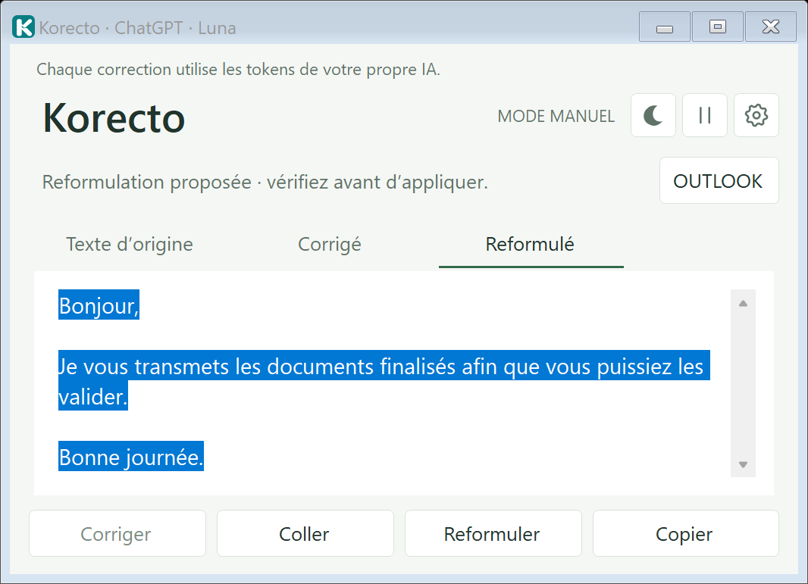

# Korecto

Correcteur de mails pour Windows. Korecto lit le brouillon ouvert dans Outlook classique, propose une version corrigée ou reformulée, et vous laisse l'appliquer ou la copier. Il n'envoie jamais le mail.



## Installation

1. Téléchargez `Korecto.exe` depuis la page [Releases](../../releases/latest).
2. Double-cliquez dessus : Korecto propose de s'installer (menu Démarrer, désinstallation par Paramètres Windows, sans droits administrateur).
3. Au premier lancement, choisissez votre IA et son modèle.

Si Windows affiche « Windows a protégé votre ordinateur », cliquez sur « Informations complémentaires », puis « Exécuter quand même » : l'exécutable n'est pas encore signé.

**Mise à jour :** quittez Korecto (clic droit sur son icône près de l'horloge, puis Quitter), téléchargez le nouvel `Korecto.exe` et double-cliquez dessus. Vos réglages sont conservés.

## Prérequis

- Windows 64 bits (testé sous Windows 11).
- Un compte IA déjà connecté sur le PC, au choix :
  - **ChatGPT** via [Codex](https://learn.chatgpt.com/docs/cli) (modèles Luna, Terra, Sol) ;
  - **Claude** via [Claude Code](https://code.claude.com/docs/en/setup) (modèles Haiku, Sonnet).
- Pour la lecture automatique : Outlook classique pour Windows. Sans Outlook, le mode Manuel fonctionne par copier-coller, y compris pour Gmail.

Aucune clé API n'est demandée : Korecto utilise votre abonnement via le client officiel. Chaque correction consomme donc le quota de votre propre compte.

## Utilisation

- **Outlook** : ouvrez un brouillon, Korecto affiche son texte en direct. Cliquez sur **Corriger** quand le mail est terminé, ou sur **Reformuler** pour une autre tournure. Rien n'est transmis à l'IA sans clic.
- **Trois onglets** : Texte d'origine, Corrigé, Reformulé. **Appliquer** remplace le texte du brouillon (un seul Ctrl+Z dans Outlook l'annule), **Copier** place la proposition dans le presse-papiers.
- **Mode Manuel** : bouton Manuel, collez votre texte, Corriger, Copier.
- La croix de la fenêtre la range près de l'horloge ; **Quitter** se trouve dans le menu de cette icône. Le thème clair ou sombre et le démarrage avec Windows se règlent dans ⚙.

## Garde-fous

- Aucun envoi de mail, aucune modification des destinataires, de l'objet ou des pièces jointes.
- Appliquer est bloqué si la suite de chiffres, de montants ou de dates diffère de l'original, ou si le mail contient un lien, une image ou un tableau (utilisez alors Copier). Ce contrôle ne garantit pas la fidélité du sens : relisez toujours.
- Le texte du brouillon (30 000 caractères maximum) est transmis à OpenAI ou à Anthropic selon votre choix. Rien n'est conservé par Korecto.
- Les clients IA sont lancés sans outils, sans shell et sans mémoire de conversation.

## Réglages et données

`%LOCALAPPDATA%\Korecto` : choix de l'IA et thème. Aucun secret n'y est stocké. À l'installation, les anciens réglages de la version portable (dossier `PARAMETRES_IA`) sont repris.

## Développement

Sources C# (.NET Framework, compilateur fourni avec Windows) dans [`src`](src).

```powershell
src\CONSTRUIRE.ps1            # compile src\Korecto.exe
src\tests\LANCER_TESTS.ps1    # 251 contrôles locaux, sans réseau ni vrai mail
```

| Dossier | Contenu |
|---|---|
| `src` | Code de l'application, consignes de correction, schéma de réponse |
| `src/tests` | Tests locaux et script de lancement |
| `src/assets` | Icônes intégrées à l'exécutable |
| `branding` | Identité Korecto : icônes, favicon, sources vectorielles |
| `docs` | [Feuille de route](docs/ROADMAP.md), captures d'écran |

Les tests utilisent des brouillons simulés. La lecture et l'application dans un vrai Outlook (signatures, listes, tableaux, réponses intégrées) restent à valider en conditions réelles.

## Licence

À définir.
